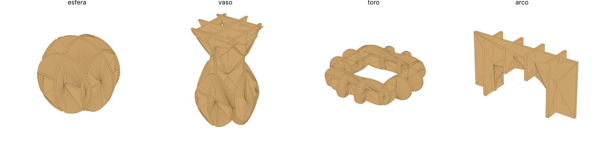
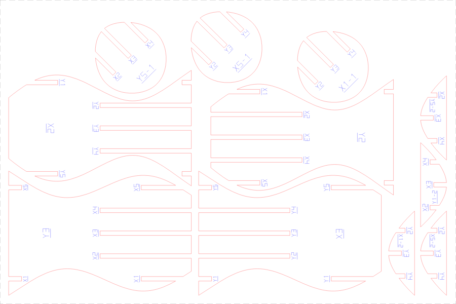
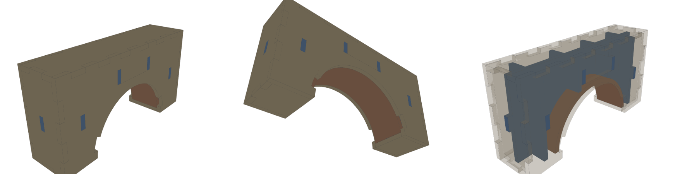
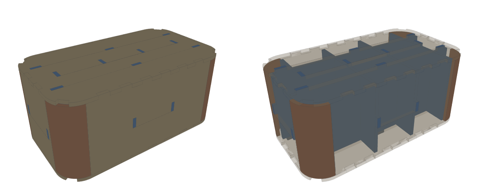
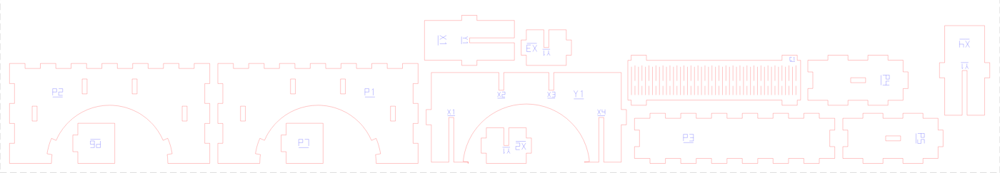

# 3d2lasercut

Transforma um modelo 3D (STL, OBJ, 3MF, PLY…) em **peças para corte a laser** em MDF, acrílico ou qualquer material em chapa, em três modos:

- **Fatias empilhadas** (`stack`): o modelo vira camadas da espessura da chapa, com furos para **pinos de alinhamento**.
- **Grade encaixada** (`waffle`): fatias verticais em X e Y com **fendas de meia altura** que se encaixam, sem cola, usando bem menos material.
- **Placas + estrutura** (`plates`): junta estética e resistência.
  - As **faces planas** viram placas inteiras, unidas por **finger joints**.
  - As **superfícies curvas simples** (abóbadas, cilindros, cantos arredondados) viram **chapas flexíveis** (*kerf bending*).
  - Por dentro, uma grade de **nervuras** se prende às placas por abas.

Em todos os modos, o programa grava o **nome de cada peça**, compensa o **kerf** do laser e distribui tudo em **chapas**, encaixando as peças pelo **contorno real**. O resultado sai pronto para LightBurn, RDWorks, LaserGRBL etc.

| Fatias empilhadas | Grade encaixada |
|---|---|
|  |  |



**Modo placas.** Placas (bege) por fora, chapa flexível (marrom) na abóbada e nervuras (azul) por dentro:







> **Status: v0.3.** Veja o [roteiro](#roteiro).

## Instalação

```bash
git clone https://github.com/neepleman/3d2lasercut && cd 3d2lasercut
pip install -e .
```

Requer Python 3.10+. As dependências são `trimesh`, `shapely`, `ezdxf`, `numpy`, `scipy`, `networkx` e `mapbox_earcut`.

## Uso rápido

```bash
3d2lasercut modelo.stl -t 3 --sheet 600x400 -o saida
```

| Opção | O que faz | Padrão |
|---|---|---|
| `-t, --thickness` | espessura **medida** da chapa (mm) | 3 |
| `-m, --mode` | `stack` (fatias empilhadas), `waffle` (grade encaixada) ou `plates` (placas + estrutura) | stack |
| `-a, --axis` | eixo vertical do modelo (empilhamento): `x`, `y`, `z` | z |
| `-s, --scale` / `-H, --height` | fator de escala, ou altura final desejada (mm) | 1 |
| `-k, --kerf` | largura do corte do laser (mm) | 0.15 |
| `--sheet` | tamanho da chapa `LxA` (mm) | 600x400 |
| `--margin`, `--spacing` | margem da chapa e espaço entre peças (mm) | 5, 3 |
| `--pin-diameter` | diâmetro da cavilha/palito (mm) | 3 |
| `--pin-clearance` | folga do furo (mm) | 0.1 |
| `--pin-margin` | parede mínima entre furo e borda (mm) | 2 |
| `--no-pins`, `--no-labels` | desliga pinos / etiquetas | — |
| `--min-area` | descarta ilhas menores que isso (mm²) | 4 |
| `--min-feature` | remove detalhes mais finos que isso (mm) | desligado |
| `--format` | `svg`, `dxf` ou `svg,dxf` | svg,dxf |
| `--no-rotate` | não gira as peças no nesting | — |

Exemplo: um vaso com 15 cm de altura, em MDF de 2,8 mm medido no paquímetro, chapa de 400×300:

```bash
3d2lasercut vaso.stl -H 150 -t 2.8 --sheet 400x300 -o vaso_corte
```

O mesmo vaso como grade encaixada, com fatias a cada 20 mm:

```bash
3d2lasercut vaso.stl -m waffle --grid 20 -H 150 -t 2.8 --sheet 400x300 -o vaso_grade
```

### Opções do modo grade (`-m waffle`)

| Opção | O que faz | Padrão |
|---|---|---|
| `--grid` | espaçamento entre fatias: `25` (X e Y iguais) ou `20x30` | 25 |
| `--slot-clearance` | folga na largura das fendas (mm) | 0.1 |

### Opções do modo placas (`-m plates`)

| Opção | O que faz | Padrão |
|---|---|---|
| `--ribs` | nervuras internas: `auto`, `none`, `on` ou o espaçamento em mm (ex.: `40`) | auto |
| `--no-tabs` | placas que ficam à vista e **não** devem ter furos de aba, ex.: `P1,P2` | — |
| `--finger-width` | largura dos dedos das juntas (mm) | 3 × espessura |
| `--no-skins` | não cobrir as superfícies curvas com chapa flexível | — |
| `--plate-min-width` | faces planas mais estreitas que isso não viram placa (mm) | 12 |

No modo `auto`, as nervuras entram quando o modelo tem regiões sem cobertura (curvas duplas, como esferas) ou passa de 10 cm. O relatório informa o motivo.

Fluxo sugerido: rode uma vez, veja no relatório a tabela de placas (tamanho, vizinhas e se têm abas aparentes) e rode de novo com `--no-tabs` nas faces "de vitrine".

```bash
3d2lasercut arco.stl -m plates --ribs 30 --no-tabs P1,P2 -o arco_placas
```

### Opções de nesting

| Opção | O que faz | Padrão |
|---|---|---|
| `--nesting` | `shape` = pelo contorno real, `shelf` = por retângulos (mais rápido) | shape |
| `--nest-res` | resolução da grade do nesting (mm): menor aperta mais, maior é mais rápido | 1.0 |

## O que sai

| Arquivo | Conteúdo |
|---|---|
| `*_chapaNN.svg` / `.dxf` | uma chapa por arquivo. **Vermelho / camada `CORTE`**: furos e contornos, com os furos primeiro. **Azul / camada `GRAVACAO`**: nomes das peças e, na grade, o nome da peça parceira ao lado de cada fenda. A camada `CHAPA` (cinza) é só referência e não deve ser cortada. |
| `*_previa.stl` | o modelo montado (pilha ou grade) como sólido; abra num visualizador 3D para conferir antes de cortar |
| `*_relatorio.md` | resumo, metros de corte, aproveitamento de cada chapa, lista de **cavilhas com comprimento** (pilha) e instruções de montagem |

## Como funciona

### Fatias empilhadas

1. **Preparação.** O modelo é orientado pelo eixo escolhido, escalado e apoiado em Z=0. Malhas abertas recebem um reparo básico.
2. **Fatiamento.** O número de camadas é `round(altura / espessura)`, com cada seção tirada no meio da camada. Cada corpo do arquivo é fatiado separadamente e depois unido, então corpos sobrepostos não viram buracos.
3. **Limpeza.** Remove ilhas minúsculas e detalhes finos demais e simplifica os contornos.
4. **Pinos.** Ficam onde duas camadas vizinhas se sobrepõem, com parede mínima até a borda. Os pinos continuam pelas camadas enquanto couberem, o que dá cavilhas longas e passantes. Cada região de contato recebe 2 pinos afastados, para impedir rotação.
5. **Etiquetas.** Número da camada, com sufixo `-1`, `-2`… quando a camada tem várias ilhas. É gravado com fonte de traço e sublinhado. O sublinhado distingue 6 de 9 e indica a face de cima.
6. **Kerf.** O contorno externo cresce kerf/2 e os furos encolhem kerf/2. A peça cortada sai na medida do modelo.
7. **Nesting**, descrito abaixo.

### Grade encaixada

1. **Fatias.** São planos verticais `x = a` e `y = b`, centrados no modelo, com espaçamento `--grid`. As fatias das pontas ficam a pelo menos meio espaçamento da borda.
2. **Cruzamentos.** Para cada par de fatias X/Y, o programa calcula onde as duas têm material na **faixa da largura da fenda**, e não só na linha central, porque a chapa tem espessura e as bordas curvas se chocariam.
3. **Fendas de meia altura.** Uma peça é aberta por cima até o meio do cruzamento e a outra por baixo. A direção é escolhida **por par de peças**, de forma a remover o mínimo de material. Isso importa quando uma fatia é dividida em duas pelo modelo: a parte de cima encaixa por cima, sem rasgar a peça vizinha inteira.
4. **Etiquetas.** Cada peça leva o próprio nome (X1, Y2, X1-2…) e, ao lado de cada fenda, o nome da peça que encaixa ali.
5. **Kerf.** As fendas encolhem kerf/2 de cada lado e saem na largura certa: espessura + folga.

### Placas + estrutura

1. **Placas.** Faces coplanares e vizinhas formam uma placa. Só viram placa as faces com área e largura mínimas, o que descarta as facetas finas de superfícies curvas. Cada placa fica **para dentro** do modelo, com a face externa coincidindo com a superfície original, e as medidas externas se mantêm.
2. **Juntas** nas arestas entre placas:
   - **90° convexo (quina):** finger joint. A placa de menor número fica com os dedos das pontas, o que resolve os cantos onde 3 placas se encontram.
   - **90° côncavo (canto interno):** os dedos avançam além da aresta para preencher o canto. Nas pontas, recuam se houver uma terceira placa.
   - **Outros ângulos:** junta de topo. As placas recuam o necessário para não se invadir nem sair do modelo, e sobra uma fresta em V para cola ou massa.
3. **Chapas flexíveis.** O programa procura regiões curvas em que todas as normais são perpendiculares a um eixo (curvatura simples).
   - A seção transversal é planificada pelo comprimento de arco, medido no lado côncavo, que não estica.
   - A chapa recebe o padrão clássico de cortes alternados (*living hinge*).
   - Ela se prende com abas nas placas das pontas e é recortada onde encontraria outras placas.
   - Superfícies de dupla curvatura (esferas) ficam a cargo das nervuras.
4. **Nervuras.** São fatias X/Y como no modo grade, mas recortadas para não invadir as placas nem as chapas flexíveis. O recorte considera a espessura da nervura nas duas faces e no meio.
   - Onde encostam numa placa perpendicular, as nervuras ganham **abas** que atravessam **furos** na placa (*tab-and-slot*).
   - As abas evitam os cruzamentos entre nervuras e as pontas das placas.
5. **Etiquetas** na **face de dentro** de cada placa, escondidas depois de montar.

Os testes montam todas as peças em 3D (booleanas com `manifold3d`) e verificam que **nenhuma peça invade outra nem sai do modelo**: caixa, degrau em L, faces inclinadas, arco, caixa arredondada e cilindro.

### Nesting pelo contorno real

Cada peça é rasterizada numa grade, já dilatada por metade do espaçamento. Uma correlação via FFT encontra, de uma só vez, todas as posições livres da chapa. Para cada peça, o programa testa 4 rotações e escolhe a posição mais baixa e mais à esquerda, colocando as maiores primeiro. A dilatação é conservadora: o espaçamento mínimo entre peças é sempre respeitado. Peças côncavas se encaixam umas nas outras e peças pequenas podem cair dentro dos furos das grandes. Com `--nesting shelf`, volta o empacotamento por retângulos, mais rápido.

## Dicas

- **Meça a chapa.** MDF "3 mm" costuma ter entre 2,8 e 3,2 mm. A altura final da pilha é `camadas × espessura`.
- **Calibre o kerf e a folga** cortando antes uma peça de teste com um furo e um pino.
- **Chapa flexível:** o raio mínimo de curvatura aparece no relatório. Abaixo de ~4× a espessura, teste a flexão antes; o MDF levemente umedecido dobra melhor.
- **Placas:** as juntas usam a mesma folga das fendas (`--slot-clearance`). Calibre com um par de placas de teste.
- **Grade:** um espaçamento menor deixa a peça mais fiel e resistente, mas gasta mais material e tempo de corte. Comece com 3× a 8× a espessura da chapa.
- **Folga das fendas:** se o encaixe ficar duro, aumente `--slot-clearance`; se ficar frouxo, diminua.
- Escolha o **eixo** que deixa as fatias mais robustas. Por exemplo, deite uma figura alta se as pernas ficarem finas demais.
- As cavilhas podem ser palitos de churrasco (≈3 mm), varetas de bambu ou de madeira, ou pinos impressos.

## Desenvolvimento

```bash
pip install -e '.[dev]'
pytest
python examples/make_models.py        # gera modelos de teste em examples/models/
3d2lasercut examples/models/vaso.stl -o saida
```

O código fica no pacote Python `laserslicer/`. O núcleo não depende do FreeCAD, para poder ser testado e usado pela linha de comando. O workbench do FreeCAD será uma interface por cima dele.

```
config.py    parâmetros            pins.py     pinos de alinhamento
mesh_io.py   carregar/orientar     parts.py    etiquetas + kerf
slicer.py    fatiar em camadas     waffle.py   grade encaixada (fendas)
plates.py    placas + juntas       skins.py    chapas flexíveis (kerf bending)
ribs.py      nervuras internas     nesting.py  distribuir nas chapas
pipeline.py  orquestra tudo        export.py   SVG, DXF, prévia, relatório
cli.py       linha de comando      font.py     fonte de traço p/ gravação
```

## Roteiro

- [x] **v0.1**: fatias empilhadas, pinos, etiquetas, kerf, nesting por retângulo, SVG/DXF
- [x] **v0.2**: grade de fatias encaixadas (*waffle*) com fendas e etiquetas de montagem; nesting pelo contorno real
- [x] **v0.3**: modo placas com finger joints automáticos, chapas flexíveis (kerf bending) nas curvas simples e nervuras internas com abas
- [ ] v0.4: workbench do FreeCAD com perguntas ao usuário (faces de vitrine, juntas fixas/móveis, dobradiças), leitura de STEP

## Licença

Copyright © 2026 Neepleman. Distribuído sob a [GNU LGPL v2.1 ou posterior](LICENSE), compatível com o FreeCAD.
