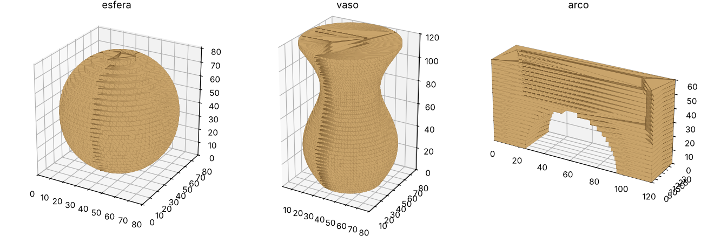
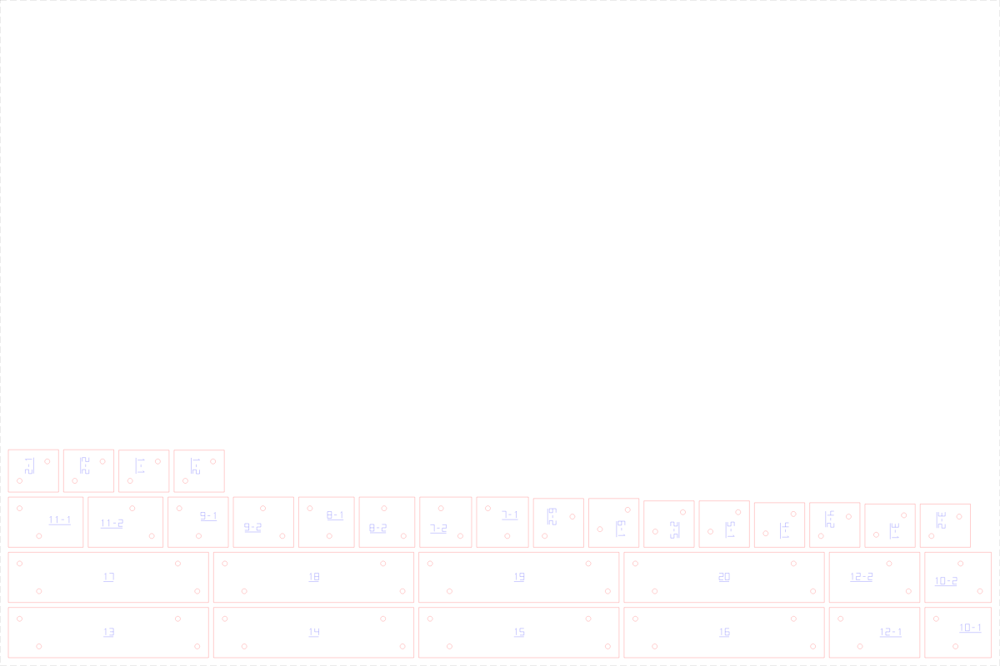

# 3d2lasercut

Transforma um modelo 3D (STL, OBJ, 3MF, PLY…) em **peças empilháveis para corte a laser** em MDF, acrílico ou qualquer material em chapa.

O programa fatia o modelo na espessura real da chapa, abre furos para **pinos de alinhamento**, grava o **número de cada peça**, compensa o **kerf** do laser e distribui tudo em **chapas** prontas para o LightBurn, RDWorks, LaserGRBL etc.





> **Status: v0.1, protótipo.** Faz o modo *fatias empilhadas*. Veja o [roteiro](#roteiro).

## Instalação

```bash
git clone https://github.com/neepleman/3d2lasercut && cd 3d2lasercut
pip install -e .
```

Requer Python 3.10+. As dependências são `trimesh`, `shapely`, `ezdxf`, `numpy`, `scipy`, `networkx` e `mapbox_earcut`.

## Uso rápido

```bash
3d2lasercut modelo.stl -t 3 --sheet 600x400 -o saida
```

| Opção | O que faz | Padrão |
|---|---|---|
| `-t, --thickness` | espessura **medida** da chapa (mm) | 3 |
| `-a, --axis` | eixo de empilhamento: `x`, `y`, `z` | z |
| `-s, --scale` / `-H, --height` | fator de escala, ou altura final desejada (mm) | 1 |
| `-k, --kerf` | largura do corte do laser (mm) | 0.15 |
| `--sheet` | tamanho da chapa `LxA` (mm) | 600x400 |
| `--margin`, `--spacing` | margem da chapa e espaço entre peças (mm) | 5, 3 |
| `--pin-diameter` | diâmetro da cavilha/palito (mm) | 3 |
| `--pin-clearance` | folga do furo (mm) | 0.1 |
| `--pin-margin` | parede mínima entre furo e borda (mm) | 2 |
| `--no-pins`, `--no-labels` | desliga pinos / etiquetas | — |
| `--min-area` | descarta ilhas menores que isso (mm²) | 4 |
| `--min-feature` | remove detalhes mais finos que isso (mm) | desligado |
| `--format` | `svg`, `dxf` ou `svg,dxf` | svg,dxf |
| `--no-rotate` | não gira as peças no nesting | — |

Exemplo: um vaso com 15 cm de altura, em MDF de 2,8 mm medido no paquímetro, chapa de 400×300:

```bash
3d2lasercut vaso.stl -H 150 -t 2.8 --sheet 400x300 -o vaso_corte
```

## O que sai

| Arquivo | Conteúdo |
|---|---|
| `*_chapaNN.svg` / `.dxf` | uma chapa por arquivo. **Vermelho / camada `CORTE`**: furos e contornos, com os furos primeiro. **Azul / camada `GRAVACAO`**: números das peças. A camada `CHAPA` (cinza) é só referência e não deve ser cortada. |
| `*_previa.stl` | o empilhamento final como sólido; abra num visualizador 3D para conferir antes de cortar |
| `*_relatorio.md` | resumo, metros de corte, peças por chapa, lista de **cavilhas com comprimento** e instruções de montagem |

## Como funciona

1. **Preparação.** O modelo é orientado pelo eixo escolhido, escalado e apoiado em Z=0. Malhas abertas recebem um reparo básico.
2. **Fatiamento.** O número de camadas é `round(altura / espessura)`, com cada seção tirada no meio da camada. Cada corpo do arquivo é fatiado separadamente e depois unido, então corpos sobrepostos não viram buracos.
3. **Limpeza.** Remove ilhas minúsculas e detalhes finos demais e simplifica os contornos.
4. **Pinos.** Ficam onde duas camadas vizinhas se sobrepõem, com parede mínima até a borda. Os pinos continuam pelas camadas enquanto couberem, o que dá cavilhas longas e passantes. Cada região de contato recebe 2 pinos afastados, para impedir rotação.
5. **Etiquetas.** Número da camada, com sufixo `-1`, `-2`… quando a camada tem várias ilhas. É gravado com fonte de traço e sublinhado. O sublinhado distingue 6 de 9 e indica a face de cima.
6. **Kerf.** O contorno externo cresce kerf/2 e os furos encolhem kerf/2. A peça cortada sai na medida do modelo.
7. **Nesting.** Cada peça é girada para o seu retângulo mínimo e distribuída por empacotamento em prateleiras, em quantas chapas forem necessárias.

## Dicas

- **Meça a chapa.** MDF "3 mm" costuma ter entre 2,8 e 3,2 mm. A altura final da pilha é `camadas × espessura`.
- **Calibre o kerf e a folga** cortando antes uma peça de teste com um furo e um pino.
- Escolha o **eixo** que deixa as fatias mais robustas. Por exemplo, deite uma figura alta se as pernas ficarem finas demais.
- As cavilhas podem ser palitos de churrasco (≈3 mm), varetas de bambu ou de madeira, ou pinos impressos.

## Desenvolvimento

```bash
pip install -e '.[dev]'
pytest
python examples/make_models.py        # gera modelos de teste em examples/models/
3d2lasercut examples/models/vaso.stl -o saida
```

O código fica no pacote Python `laserslicer/`. O núcleo não depende do FreeCAD, para poder ser testado e usado pela linha de comando. O workbench do FreeCAD será uma interface por cima dele.

```
config.py    parâmetros            pins.py     pinos de alinhamento
mesh_io.py   carregar/orientar     parts.py    etiquetas + kerf
slicer.py    fatiar em camadas     nesting.py  distribuir nas chapas
pipeline.py  orquestra tudo        export.py   SVG, DXF, prévia, relatório
cli.py       linha de comando      font.py     fonte de traço p/ gravação
```

## Roteiro

- [x] **v0.1**: fatias empilhadas, pinos, etiquetas, kerf, nesting por retângulo, SVG/DXF
- [ ] v0.2: grade de fatias encaixadas (*waffle*/slots cruzados), nesting por formato real
- [ ] v0.3: modo placas para peças com faces planas (STEP/FreeCAD) com finger joints automáticos
- [ ] v0.4: workbench do FreeCAD com perguntas ao usuário (juntas fixas/móveis, dobradiças, kerf bending)

## Licença

Copyright © 2026 Neepleman. Distribuído sob a [GNU LGPL v2.1 ou posterior](LICENSE), compatível com o FreeCAD.
